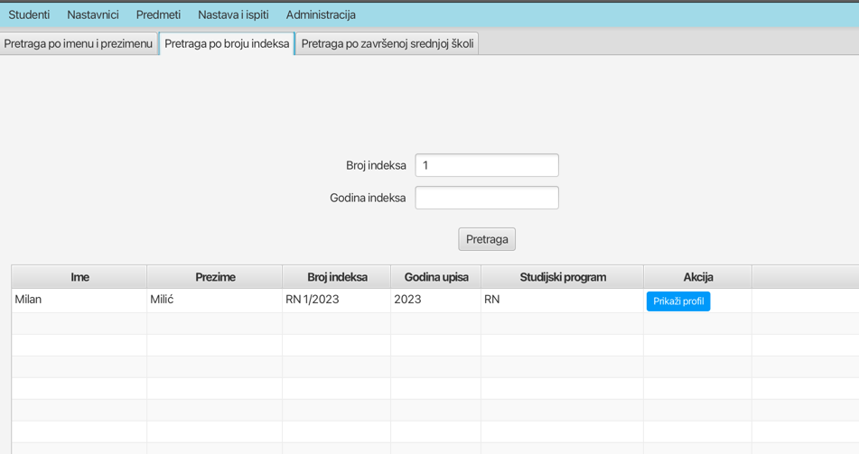

# 1. Rad sa podacima o studentima

Moguće je pronaći studenta za uneti broj indeksa pri čemu se otvara posebna stranica koja sadrži celokupan profil studenta, lične podatke, sve položene i nepoložene ispite, uplate, pregled upisanih i obnovljenih godina, ukupan broj ostvarenih ESPB, trenutnu prosečnu ocenu,... Preporućeno je da se ovi elementi organizuju u posebne tabove.

- [x] Potrebno dodati opciju za biranje smera kada se pretrazuje student po indeksu 
- [x] Nedostaje uplata na prikazu profila studenta - * Nedostaje skolska godina da se prikazuje u tabeli pri novoj uplati
- [ ] 

# 2. Predmeti
- [ ] Dodavanje novog predmeta?

- [ ] Proveriti asinhrone pozive 
- Ključne Karakteristike:
  ✅ WebClient za sve asinhrone pozive
  ✅ Mono/Flux za reactive streams
  ✅ Platform.runLater() za UI thread ažuriranja
  ✅ Loading indikatori (disable dugmadi + "Učitavanje..." tekst)
  ✅ Error handling sa onErrorReturn() i subscribe error callbacks
  ✅ Mono.zip() za paralelnu izvršavanje više async poziva
  ✅ Nema UI blokiranja

    /**
     * Async reactive version using WebClient and Mono.
     */
    public Mono<List<StudentReportDTO>> getStudentsForReportAsync() {
        return webClient.get()
                .uri(createURL("report"))
                .retrieve()
                .bodyToMono(StudentReportDTO[].class)
                .map(array -> List.of(array));
    }
}

- [ ] Ukloniti nepotrebne menu item-e

# Za odbranu

- [ ] Asinhroni pozivi za pozivanje:
- pretrage studenata npr
- generisanje izvestaja

- [ ] HandleBack - kako zna gde je bio